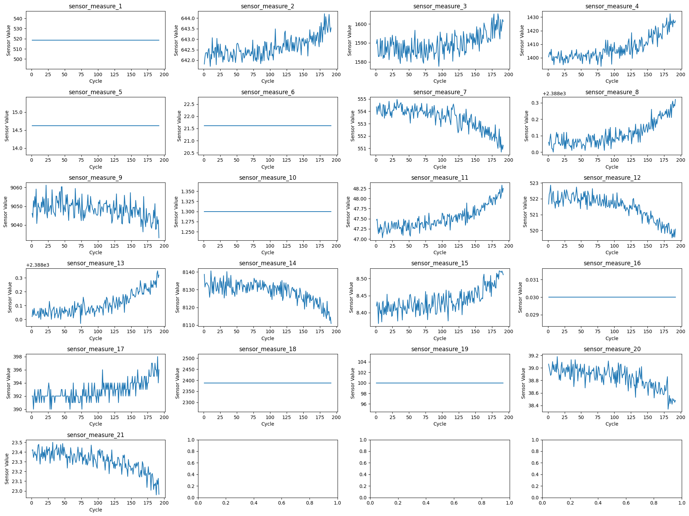
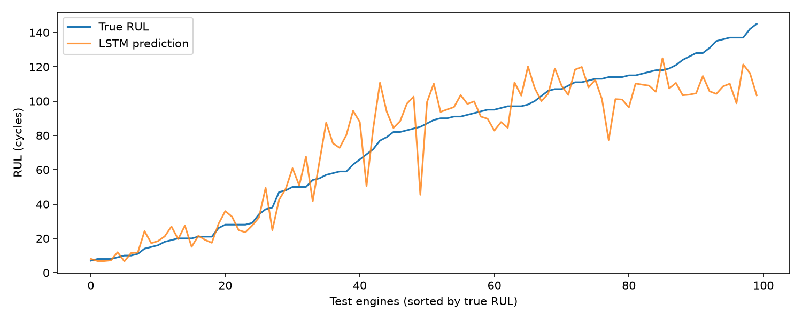

# NASA Turbofan Engine Remaining Useful Life (RUL) Prediction

## Project Overview

This project implements a **predictive maintenance system** to estimate the **Remaining Useful Life (RUL)** of aircraft turbofan engines using **multivariate time-series sensor data**.

Using the **NASA CMAPSS Turbofan Engine Dataset**, several machine learning models were trained and compared before implementing a **Long Short-Term Memory (LSTM)** deep learning model to capture temporal degradation patterns in engine sensor data.

The objective is to predict how many operational cycles remain before an engine fails, enabling **proactive maintenance and failure prevention**.

---

## Dataset

The dataset used is the **NASA Turbofan Engine Degradation Simulation Dataset (CMAPSS)**.

Each engine contains multiple cycles of sensor measurements until failure.

### Dataset Structure

Each row contains:

* Engine ID
* Time cycle
* 3 operational settings
* 21 sensor measurements

As engines operate over time, the sensor readings change due to **mechanical wear and degradation**.

The goal is to use these sensor readings to predict the **Remaining Useful Life (RUL)** of the engine.

---

## Project Workflow

### 1. Data Loading

The turbofan dataset was loaded and column names were assigned for:

* engine id
* cycle number
* operational settings
* sensor measurements

---

### 2. RUL Label Generation

For the training dataset, the Remaining Useful Life was computed using:

RUL = Maximum Cycle of Engine − Current Cycle

This creates the target variable that the model learns to predict.

---

### 3. Data Cleaning and Sensor Selection

## Sensor Degradation Visualization

To better understand the behavior of the turbofan engines, an exploratory analysis was performed on the sensor measurements across engine cycles.

The following visualization shows how each sensor measurement evolves over time for a sample engine. This helps identify sensors that exhibit clear degradation patterns as the engine approaches failure.

<p align="center">
  
</p>

### Observations

* Some sensors show **clear degradation trends** as the engine cycles increase, indicating useful predictive signals for Remaining Useful Life estimation.
* Certain sensors exhibit **monotonic increases or decreases**, suggesting that they are strongly correlated with engine wear.
* A few sensors remain **constant or nearly constant across cycles**, indicating that they do not provide meaningful information for predicting failure.

### Feature Selection Insight

Based on this analysis:

* Sensors with **little or no variation** were removed from the dataset.
* Sensors showing **clear temporal degradation patterns** were retained for model training.

This step helps reduce noise, improve model performance, and ensure that the model focuses on **informative degradation signals**.


### 4. Feature Scaling

Sensor measurements have different numerical ranges. Feature scaling was applied to normalize the values and ensure stable training of machine learning and deep learning models.

---

### 5. Sequence Generation

Since engine degradation is **time dependent**, the dataset was converted into sequences using a **sliding window approach**.

Example:

Cycles 1–30 → Predict RUL
Cycles 2–31 → Predict RUL
Cycles 3–32 → Predict RUL

This converts the dataset into a **3D structure required for LSTM models**:

(samples, time_steps, features)

---

## Results — v2 (FD001 official test set, 100 engines, mean ± std over 3 seeds)

| Model | RMSE ↓ | NASA score ↓ |
|-------|--------|--------------|
| **XGBoost** (flattened 30-cycle windows) | **14.60 ± 0.13** | **311 ± 10** |
| LSTM (64 → 32) | 14.97 ± 0.18 | 332 ± 10 |
| Random Forest | 17.27 ± 0.14 | 637 ± 27 |

NASA score is the asymmetric CMAPSS metric: late predictions (overestimating remaining life) are penalised exponentially harder than early ones, because a late prediction means a missed failure.



### Ablation: RUL cap

| Model | Uncapped target | Capped at 125 |
|-------|-----------------|---------------|
| LSTM | 26.48 ± 1.46 (score 14,762) | **14.97** (score 332) |
| XGBoost | 22.35 ± 0.62 (score 12,396) | **14.60** (score 311) |
| Random Forest | 23.61 ± 0.13 (score 3,597) | **17.27** (score 637) |

Without the cap, models predict very long lives for healthy engines and are badly late on many of them — visible in the ~40× worse NASA score.

## What changed from v1 → v2

My first version (`v1_exploration.ipynb`) reported **RMSE 22.4**, but that was validation on a random split of overlapping windows. On the official test set it scored **32.8**.

| Issue in v1 | Fix in v2 | Why |
|-------------|-----------|-----|
| Random split of overlapping 30-cycle windows | **Engine-wise split** (80 / 20 engines) | Adjacent windows share 29/30 cycles — a random split leaks training data into validation |
| Uncapped RUL target | **Piecewise-linear cap at 125** | Early-life cycles show no degradation; predicting RUL 300 vs 200 is unlearnable noise |
| Trees on single rows, LSTM on windows | **All models on identical 30-cycle windows** | Fair comparison |
| `time_in_cycles` used as a feature | Removed | Leaks age directly instead of learning degradation |
| Label = RUL of the *next* cycle | Label = RUL at the window's last cycle | Matches how test prediction works |
| Scaler fit before split | Fit on training engines only | Avoids leakage |
| Unscaled target, early stopping too eager | Target scaled to [0,1], gradient clipping, LR decay | One LSTM seed collapsed to predicting the mean before this fix |

**Net effect:** LSTM official test RMSE **32.8 → 15.0**.

## Key finding: XGBoost matches the LSTM on FD001

FD001 has a single operating condition and one fault mode, so degradation is smooth and close to monotonic. With only 100 training engines, a flattened 30-cycle window already captures the trend, and gradient-boosted trees match the sequence model. Sequence models are expected to pull ahead on FD002/FD004 (six operating conditions) — the natural next experiment.

## Run

```bash
python -m venv .venv && .venv\Scripts\activate
pip install -r requirements.txt
python RUL_V2.py        # set CAP = 10**6 on line 13 for the ablation
```

## Technologies Used

* Python
* NumPy
* Pandas
* Scikit-learn
* TensorFlow / Keras
* Matplotlib
* Seaborn
* Jupyter Notebook

---

## Applications

This project demonstrates **predictive maintenance**, which is widely used in:

* Aviation
* Manufacturing
* Industrial machinery
* Energy systems

Predicting Remaining Useful Life helps organizations:

* reduce downtime
* prevent unexpected failures
* optimize maintenance schedules
* reduce operational costs

---

## Future Improvements

Possible improvements include:

* GRU-based sequence models
* CNN + LSTM hybrid architectures
* Attention mechanisms
* Transformer-based models
* Hyperparameter tuning

